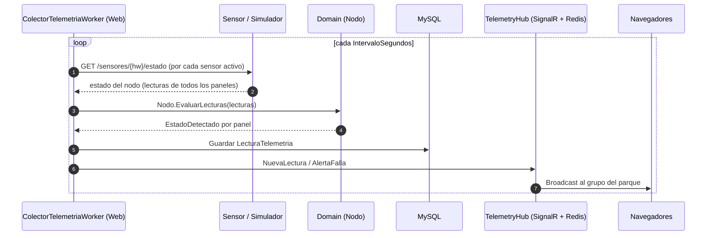

# Simulador de Sensor e Inversor (caja negra) - SolarUY

## 1. Qué se simula y qué no

Según la letra, cada nodo tiene un **inversor** que concentra la información de todos sus paneles, y un **sensor** (hardware ARM) acoplado que permite *pedirle información* al inversor y *enviarle órdenes* (activar/desactivar un panel, activar/desactivar el volcado a la red). El sensor NO es parte del software de gestión.

```
Software de gestión  ↔  Sensor (ARM)  ↔  API local del inversor  ↔  estado de paneles
   (SolarUY.Web)         └────────── lo que simula SolarUY.SensorSimulator ──────────┘
```

La letra no define la API del sensor. La definimos nosotros (sección 3), y el simulador y el sistema de gestión se acoplan solo a ese contrato.

**Implementación:** proyecto `SolarUY.SensorSimulator` (ver su README), ASP.NET Core Minimal API sobre `net10.0`, con proyecto de tests `SolarUY.SensorSimulator.Tests` (xUnit). Escucha en `http://localhost:5100`.

## 2. Decisiones de diseño

| Decisión | Elección | Por qué |
|---|---|---|
| Modelo de comunicación | **Pull**: el sistema consulta al sensor y le manda órdenes | Es lo que describe la letra ("pedirle información", "mandarle órdenes") |
| Qué es el simulador | Proyecto `SolarUY.SensorSimulator`: un ASP.NET Core Minimal API que emula N sensores+inversores, cada uno con X paneles | Caja negra: el sistema no sabe si habla con hardware real o simulado |
| Dependencias del simulador | Ninguna hacia `Domain`, `Application` ni `Infrastructure` | Mantiene la caja negra real |
| Quién consulta | `ColectorTelemetriaWorker` (BackgroundService) dentro de `SolarUY.Web` | Puede usar `IHubContext` para notificar por SignalR |
| Instancias del colector | **Una sola**, habilitada por configuración en un único nodo web (`Colector:Habilitado`) | Con varios nodos, cada colector duplicaría lecturas. Limitación conocida: si ese nodo cae, no hay colección hasta levantarlo |
| Dónde se evalúa el estado | En `Domain` (`Nodo.EvaluarLecturas`), nunca en el simulador | El sensor mide, no diagnostica; la regla es testeable |
| Cuántos nodos y paneles | Configurables (N nodos × X paneles) y agregables en caliente | Para demos de distinto tamaño sin tocar código |
| Cómo se vincula con el sistema | Por `IdentificadorHardwareARM` (sensor) y `CodigoPanel` (panel) | Ver sección 5 |
| Seguridad | **Ninguna.** Sin API key ni autenticación | Es un mock local para pruebas. Solo escucha en `localhost`; no exponerlo fuera de la máquina o red local |

## 3. Contrato de la API del sensor (la que consulta el sistema)

Un único proceso simulador atiende a todos los sensores, enrutando por el identificador de hardware (sin distinguir mayúsculas: `ARM-001` equivale a `arm-001`). En un parque real, cada sensor tendría su propia dirección (`SensorDispositivo.UrlBase`).

### GET `/sensores/{identificadorHardwareARM}/estado`

```json
{
  "identificadorHardwareARM": "ARM-001",
  "fechaHoraUtc": "2026-10-07T15:30:00Z",
  "volcadoRedActivo": true,
  "eficienciaConversion": 0.97,
  "paneles": [
    {
      "codigoPanel": "P01",
      "activo": true,
      "corrienteContinua": 8.2,
      "voltaje": 31.5,
      "potenciaGeneradaWatts": 258.3,
      "temperaturaCelsius": 48.7
    }
  ]
}
```

Nombres alineados con `LecturaTelemetria`. JSON en camelCase. **No incluye `EstadoDetectado`**: lo calcula el sistema.

Los valores se redondean a 2 decimales. `fechaHoraUtc` es la hora del sensor en UTC (formato ISO 8601 con `Z`).

### Órdenes

| Método y ruta | Efecto |
|---|---|
| `POST /sensores/{hw}/paneles/{codigo}/activar` | Reactiva el panel |
| `POST /sensores/{hw}/paneles/{codigo}/desactivar` | Desactiva el panel: `activo=false` y lecturas en cero |
| `POST /sensores/{hw}/volcado/activar` | `volcadoRedActivo = true` |
| `POST /sensores/{hw}/volcado/desactivar` | `volcadoRedActivo = false` |

Respuestas: `200` (ok, devuelve el mismo JSON que `GET /estado` con el estado resultante), `404` (sensor o panel inexistente), `409` (el estado ya estaba aplicado: por ejemplo, desactivar un panel ya desactivado).

### Seguridad
**Sin autenticación.** Ninguna ruta exige header ni clave: el simulador es un mock para pruebas. Si el contrato real del sensor llegara a exigir autenticación, el cliente del sistema (`SensorHttpClient`) es el único lugar a adaptar.

## 4. API de control del simulador (solo existe en el mock)

No forma parte del contrato real. Sirve para demos y defensa.

| Método y ruta | Efecto | Respuestas |
|---|---|---|
| `GET /simulador/inventario` | Lista sensores y paneles simulados (para copiar los códigos al dar de alta en el CRUD) | 200 |
| `POST /simulador/sensores` con `{ "identificadorHardwareARM": "ARM-004", "cantidadPaneles": 6, "potenciaNominalW": 300 }` | Agrega un nodo con X paneles en caliente. `potenciaNominalW` es opcional (por defecto, la configurada) | 201, 400, 409 |
| `DELETE /simulador/sensores/{hw}` | Quita un sensor simulado (el sistema lo verá no responder) | 204, 404 |
| `POST /simulador/fallas/{hw}/{codigo}?tipo=sobretemperatura\|caidaPotencia` | Fuerza una falla en un panel; dura hasta que se la restablece | 200, 400 (tipo ausente o inválido), 404 |
| `DELETE /simulador/fallas/{hw}/{codigo}` | Restablece el panel (idempotente: si no tenía falla, también responde 204) | 204, 404 |

**Validación del alta:** `identificadorHardwareARM` obligatorio, hasta 50 caracteres, solo letras, números, `-` y `_` (viaja en la URL); `cantidadPaneles` entre 1 y 200; `potenciaNominalW`, si se envía, mayor que 0. Un identificador repetido responde `409`.

**Inventario** (forma de la respuesta): por sensor, `identificadorHardwareARM`, `volcadoRedActivo` y `paneles[]` con `codigoPanel`, `potenciaNominalW`, `activo`, `falla` (`"sobretemperatura"`, `"caidaPotencia"` o `null`) y `fallaForzada`.

## 5. Vinculación entre el sistema y el simulador

El sistema es la fuente de verdad de parques, nodos y paneles (CRUD). El simulador solo conoce códigos de hardware. Se vinculan por:

- `SensorDispositivo.IdentificadorHardwareARM` ↔ `identificadorHardwareARM` del simulador.
- `PanelSolar.CodigoPanel` ↔ `codigoPanel` del simulador.

**Cambios al dominio que esto requiere (a reflejar en `specs.md` §2.1):**
- `SensorDispositivo`: agregar `string UrlBase`.
- `PanelSolar`: agregar `string CodigoPanel` (único dentro del nodo) y `bool Activo`.

**Flujo de alta para una demo:**
1. Levantar el simulador. Consultar `GET /simulador/inventario`.
2. En el sistema, crear Parque → Nodo → Inversor → Sensor (con el hardware ID y la URL) → Paneles (con los códigos).
3. El colector detecta el sensor activo y empieza a consultarlo.

## 6. Configuración del simulador (`appsettings.json`)

```json
{
  "Simulador": {
    "NodosIniciales": 3,
    "PanelesPorNodo": 5,
    "PotenciaNominalPanelW": 300,
    "PrefijoHardware": "ARM-",
    "ZonaHoraria": "America/Montevideo",
    "ProbabilidadFalla": 0.01,
    "DuracionFallaSegundos": 120,
    "EficienciaConversion": 0.97,
    "Nodos": []
  }
}
```

- Con la configuración por defecto se generan `ARM-001`…`ARM-003`, con paneles `P01`…`P05`.
- Para topologías no uniformes se usa la lista explícita `Nodos`; si tiene elementos, reemplaza a `NodosIniciales` y `PanelesPorNodo`: `"Nodos": [ { "id": "ARM-001", "paneles": 6 }, { "id": "ARM-002", "paneles": 4, "potenciaNominalW": 450 } ]`.
- Si la zona horaria configurada no existe en el sistema, se usa UTC-3 fijo (Uruguay no tiene horario de verano).

## 7. Generación de valores (se calculan al responder `/estado`)

- `factorSolar = max(0, sin(π · (horaLocal − 6) / 12))` → cero de noche, pico al mediodía, usando la zona horaria configurada.
- `potencia = potenciaNominalW · factorSolar · (1 + ruido ±5%)`.
- `voltaje`: entre 30 y 32 V, también de noche (simplificación; un panel real caería a casi 0 V sin luz). `corriente = potencia / voltaje`.
- `temperatura = 20 + 30 · factorSolar + ruido (±1,5 °C)`, correlacionada con la potencia.
- **Panel desactivado:** `activo=false`, corriente, voltaje y potencia en cero; temperatura ambiente (20 °C ± 1). No entra en fallas aleatorias.
- **Falla aleatoria:** al responder, cada panel sano y activo tiene `ProbabilidadFalla` de entrar en falla. Dura `DuracionFallaSegundos` y se recupera sola. Tipos: `sobretemperatura` (temperatura siempre por encima de 80 °C, incluso de noche, para que sea demostrable a cualquier hora) o `caidaPotencia` (potencia reducida a la mitad).
- **Falla forzada:** por la API de control (sección 4). Persiste hasta que se la restablece.
- El estado vive en memoria (fallas, paneles activos, volcado). Al reiniciar el simulador vuelve a la configuración inicial.

## 8. Lado del sistema (colector y órdenes)

### Piezas
(Esta sección describe el lado del sistema de gestión, que todavía no está implementado; el simulador ya cumple su parte del contrato.)
- **`ISensorClient`** (`SolarUY.Application`): `ObtenerEstadoAsync`, `ActivarPanelAsync`, `DesactivarPanelAsync`, `ActivarVolcadoAsync`, `DesactivarVolcadoAsync`. Es la abstracción que permite cambiar simulador por hardware real.
- **`SensorHttpClient`** (`SolarUY.Infrastructure`): implementación con `HttpClient`, usando `SensorDispositivo.UrlBase` de cada sensor.
- **`ColectorTelemetriaWorker`** (`SolarUY.Web`, `BackgroundService`): ciclo periódico, solo si `Colector:Habilitado = true`.

### Flujo de monitoreo



### Flujo de órdenes
Un `Administrador` pulsa "desactivar panel" en la Web → el controlador llama a `ISensorClient` → el sensor responde `200` → recién entonces se actualiza `PanelSolar.Activo` / `Inversor.VolcadoRedActivo` en el dominio y se notifica por SignalR. Si el sensor no responde o rechaza la orden, el dominio no cambia y el usuario ve el error.

### Robustez
- Cada sensor se consulta con timeout (propuesta: 3 s) y manejo de errores propio: que un sensor falle no frena a los demás.
- Propuesta: tras 3 fallos consecutivos de un sensor, sus paneles pasan a `DESCONECTADO` y se emite una alerta. A confirmar.

## 9. Regla de caída de potencia (decidido: opción b)

**Decisión:** la caída de potencia se mide contra el **promedio de los demás paneles del mismo nodo**. Se descartó (a) potencia esperada por curva, porque obliga al servidor a conocer la curva solar del simulador, y (c) lectura anterior, porque falla al amanecer y al atardecer.

**Cómo se calcula:**
1. Rendimiento relativo del panel: `potenciaGeneradaWatts / potenciaNominalW` (normaliza paneles de distinta potencia).
2. Promedio del rendimiento relativo de los **otros paneles activos** del nodo (se excluye al evaluado y a los desactivados).
3. `caida = 1 − (rendimientoPanel / promedioOtros)`.

**Estados resultantes:**

| Caída respecto al promedio del nodo | Estado |
|---|---|
| hasta 15% | `OPERATIVO` |
| más de 15% y hasta 40% | `RENDIMIENTO_BAJO` |
| más de 40% | `FALLA_DETECTADA` |
| panel con `activo = false` | `DESCONECTADO` |

**Regla de temperatura (independiente):** `temperaturaCelsius > 75` → `FALLA_DETECTADA`.

**Casos borde:**
- **De noche o con poca luz:** si `promedioOtros` es menor al 5% de la nominal, no se evalúa la caída (evita falsos positivos).
- **Menos de 2 paneles activos con lectura en el nodo:** no hay referencia, no se evalúa la caída. La regla de temperatura sigue vigente.
- **Falla simultánea de todo el nodo:** esta regla no la detecta, porque todos bajan juntos. Limitación conocida de la opción (b).

**Dónde vive:** en `Domain`, en `Nodo` (`Nodo.EvaluarLecturas(IReadOnlyList<LecturaTelemetria>)`), porque necesita ver a los paneles hermanos. Cada consulta al sensor devuelve todos los paneles del nodo, así que el colector tiene siempre el conjunto completo. Se cubre con tests unitarios (noche, panel único, panel desactivado, fronteras 15% / 15,1% / 40% / 40,1%, temperatura).

## 10. Dimensionamiento

Con 3 nodos × 5 paneles y un ciclo cada 5 s: 15 lecturas cada 5 s, unas 260 mil filas por día. Con 6 nodos × 5 paneles son unas 520 mil por día. Índice recomendado en `lecturas_telemetria`: `(panel_solar_id, fecha_hora)`. Definir política de retención (purgar o agregar lecturas viejas) antes de dejar el simulador corriendo varios días.

## 11. Pruebas del simulador

`dotnet test` en la solución del simulador ejecuta:
- **Unitarios:** curva solar (0 de noche, 1 al mediodía, simétrica), rangos de potencia (±5 %), voltaje (30–32 V) y temperatura, fallas forzadas (sobretemperatura > 75 °C a cualquier hora, caída a la mitad), fallas aleatorias (con vencimiento, recuperación, probabilidad 0 y 1), órdenes de paneles y de volcado, registro de sensores (identificadores sin distinguir mayúsculas).
- **Integración** (`WebApplicationFactory`, reloj fijado al mediodía de Montevideo): cada ruta de las secciones 3 y 4 con sus códigos 200 / 201 / 204 / 400 / 404 / 409 y la forma del JSON en camelCase.
